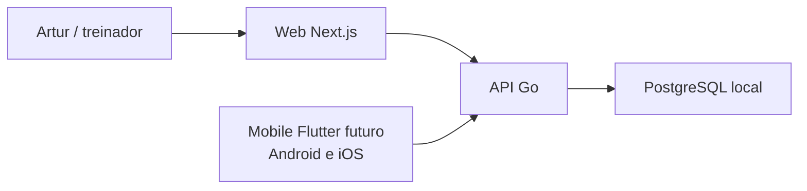

# SysAP

O SysAP e a plataforma de acompanhamento esportivo do Artur Performance. Seu
objetivo e transformar dados reais de treino em historico e informacao
explicavel, sem atribuir aos dispositivos medidas que eles nao produzem.

## Estado atual

O SysAP encontra-se na **Fase 1 — Fundação, Identidade e Acesso**, com a fundação técnica e o fluxo completo de identidade e acesso substancialmente concluídos:
PostgreSQL/Supabase local (Auth, banco com RLS forcada e caixa de e-mail de
testes local), API Go em monolito modular, painel e rotas de autenticacao em
Next.js, contrato OpenAPI e gates locais/CI. O usuário reportou a homologação manual do fluxo principal (MFA administrativo, turma, cadastro, ativação e acesso do atleta). A recuperação presencial de senha ainda não foi homologada manualmente; os testes automatizados de banco dependem de uma instância isolada.

Funcionalidades disponiveis localmente:
- Provisionamento administrativo inicial (`pnpm bootstrap:owner`) de organizacao
  e proprietario (`owner`) em ambiente local;
- Login por matricula de 10 digitos e senha (`POST /v1/auth/login`), sessao
  controlada por cookies `HttpOnly`, renovacao (`POST /v1/auth/refresh`) e
  encerramento de sessao (`POST /v1/auth/logout` e `POST /v1/auth/logout-all`);
- Elevacao de sessao administrativa a `AAL2` via TOTP (`GET /v1/auth/mfa`,
  `POST /v1/auth/mfa/enroll`, `POST /v1/auth/mfa/challenge`,
  `POST /v1/auth/mfa/verify`);
- Criacao e listagem de turmas ativas da organizacao
  (`POST /v1/organizations/{organization_id}/training-groups` e
  `GET /v1/organizations/{organization_id}/training-groups`);
- Cadastro administrativo de atleta com geracao de matricula no fuso
  `America/Fortaleza`, persistencia atomica antes do envio, entrega de matricula
  para a caixa de e-mail local e reenvio controlado
  (`POST /v1/organizations/{organization_id}/athlete-invitations`,
  `GET /v1/organizations/{organization_id}/athlete-invitations/{invitation_id}`,
  `POST /v1/organizations/{organization_id}/athlete-invitations/{invitation_id}/resend`);
- Ativacao de conta de atleta por OTP e definicao de senha
  (`POST /v1/activation/start`, `POST /v1/activation/verify`,
  `POST /v1/activation/complete`);
- Recuperacao de senha sem enumeracao de contas e com revogacao de sessoes
  (`POST /v1/auth/password-recovery/start`,
  `POST /v1/auth/password-recovery/verify`,
  `POST /v1/auth/password-recovery/complete`);
- Consulta de identidade e vinculos autorizados (`GET /v1/me`).

O cadastro e a listagem de atletas, o perfil autenticado do atleta e a criação
de turmas usam a API. Chamada/presença e operações financeiras ainda não têm
contrato/backend disponível e permanecem indisponíveis. A demonstração local,
quando habilitada explicitamente em desenvolvimento, usa estado fictício e não
substitui os fluxos reais.



Clientes consultam dados de negocio somente pela API. O Web nao acessa tabelas
PostgreSQL diretamente.

## Estrutura do monorepo

```text
apps/api/             API Go em monolito modular
apps/web/             dashboard responsivo do treinador
apps/mobile/          Flutter/Dart + adapters Kotlin/Swift futuros (ainda ausente)
assets/brand/         identidade visual canonica
contracts/openapi/    contrato HTTP da API
docs/                 arquitetura, design e seguranca
infra/supabase/       configuracao, migration e seed local
scripts/              orquestracao e gates locais
.github/workflows/    CI sem deploy
```

O aplicativo futuro usara Flutter/Dart para Android e iOS. Kotlin ficara apenas
atras de adapters Android, como Health Connect, e Swift atras de adapters Apple,
como HealthKit. `apps/mobile` ainda nao foi criado. Nao existe aplicativo de
smartwatch no MVP.

## Pre-requisitos

- Go oficial 1.26.5 para `linux/amd64`;
- Node.js 24.18.0;
- pnpm 11.15.1;
- Docker Engine 29.3.1 ou compativel;
- Docker Compose v5.1.1 ou compativel.

O Supabase CLI 2.109.1 e uma dependencia local do workspace; nao o instale
globalmente.

## Instalacao segura

```sh
pnpm install --frozen-lockfile --ignore-scripts
```

As dependencias diretas usam versoes exatas. Pacotes novos respeitam quarentena
minima de sete dias. Nao habilite lifecycle scripts sem revisar a necessidade,
origem e conteudo do pacote.

## Execucao local integrada

**Homologação manual reportada:** o percurso principal em duas sessões foi
concluído pelo usuário. A recuperação presencial de senha ainda não tem
confirmação manual. Os testes de integração PostgreSQL/Supabase não são
considerados aprovados sem instância descartável isolada. Não execute
`db:reset` sobre um banco com dados que devam ser preservados.

```sh
pnpm dev
```

O comando verifica as portas, inicia o banco quando necessario, gera e le a
configuracao local sem `source` ou `eval`, compila/inicia a API em
`http://127.0.0.1:8080` e inicia o Web em `http://127.0.0.1:3000`. Ctrl+C encerra
somente API e Web criados pelo comando. O banco e parado apenas quando o proprio
comando o iniciou.

## Execucao manual em terminais separados

Terminal 1, banco local:

```sh
pnpm db:start
pnpm db:reset
pnpm db:lint
pnpm db:env
```

Terminal 2, API:

```sh
pnpm dev:api
```

Terminal 3, Web:

```sh
pnpm dev:web
```

Ao terminar, interrompa API e Web com Ctrl+C e execute `pnpm db:stop`. Os
scripts manuais tambem mantem listeners somente em loopback e nunca imprimem a
URL do banco.

## Banco local

```sh
pnpm db:start
pnpm db:status
pnpm db:reset
pnpm db:lint
pnpm db:env
pnpm db:stop
```

`db:reset` recria o banco local e aplica migrations do zero; nao o use contra
um ambiente com dados que precisem ser preservados. O schema `app` e privado e
a API assume o papel restrito `sysap_api`. Nao ha vinculo com Supabase remoto.

## Bootstrap do administrador local e caixa de e-mail de testes

Com o Supabase local em execucao (`pnpm db:start` e `pnpm db:env`), crie uma
organizacao e um administrador (`owner`) ficticio local executando o assistente
interativo:

```sh
pnpm bootstrap:owner
```

O comando solicita interativamente nome da organizacao, fuso horario (padrao
`America/Fortaleza`), nome completo, e-mail, celular em formato E.164 (ex.:
`+5585999990001`) e senha forte (minimo de 15 caracteres, 4 numeros e 2 simbolos
especiais), exibindo ao final a matricula de 10 digitos gerada para o `owner`
(sem registrar a senha nos logs). Caso ja exista uma organizacao provisionada no
banco local, a matricula e a organizacao permanecem registradas em
`app.login_enrollments` e `app.organizations`.

A caixa de e-mail de testes local (Inbucket/Mailpit do Supabase local) fica
disponivel em:

- Interface Web da caixa de e-mail local: `http://127.0.0.1:54324`
- Porta SMTP local usada pela API e pelo Supabase Auth: `127.0.0.1:54325`

Todos os e-mails de matricula, OTP de ativacao e OTP de recuperacao de senha sao
entregues exclusivamente nessa caixa local em desenvolvimento.

## API

- `GET http://127.0.0.1:8080/healthz`: processo ativo, independente do banco;
- `GET http://127.0.0.1:8080/readyz`: 200 com banco disponivel, 503 sem banco;
- Endpoints `/v1/*` de autenticacao, sessao, MFA, recuperacao de senha,
  identidade (`/v1/me`), turmas ativas e convites/ativacao de atletas conforme
  documentado em `contracts/openapi/openapi.yaml`.

As respostas sao JSON sem cache, possuem request ID gerado pelo servidor e nao
exibem erro PostgreSQL nem detalhes de conexao.

## Web

O painel responsivo e as telas de autenticacao (`/login`, `/verificar-identidade`,
`/ativar`, `/recuperar-acesso` e `/admin/atletas/novo`) conversam com a API Go
somente por rotas BFF no servidor Next.js, mantendo tokens em cookies `HttpOnly`
e sem enviar `SYSAP_API_BASE_URL` ou chaves do Supabase ao navegador.

## Testes e gates

```sh
pnpm check
pnpm test
pnpm test:api
pnpm test:web
pnpm test:integration
pnpm security:dependencies
pnpm security:secrets
```

`pnpm check` verifica formato Go sem reescrever, modulos, vet, testes com race,
build da API, lint/typecheck/testes/build Web, OpenAPI e scripts. Ele nao inicia
o banco. `test:integration` exige a stack inicialmente parada, aplica migrations
do zero, exercita PostgreSQL real, API e Web, valida `/healthz` (200), `/readyz`
(200 e 503 quando o banco para) e a rota pública `/login` (200), e limpa tudo
mesmo em falha. A interface atual não expõe uma rota pública com contrato
observável para o estado de degradação do backend; essa condição não é declarada
como coberta pela integração Web.

## OpenAPI

O contrato local esta em `contracts/openapi/openapi.yaml`. Os endpoints
implementados estao marcados com `x-sysap-implementation-status: implemented` e
os endpoints futuros permanecem com `x-sysap-implementation-status: planned`:

```sh
pnpm openapi:lint
```

O lint nao publica documentacao. Testes Go preservam os corpos aprovados byte a
byte e a integracao comprova o comportamento real.

## Variaveis de ambiente

`.env.example` e versionado e documenta somente nomes e valores locais
ficticios. `.env.local` e ignorado, criado com permissao `0600` por `pnpm db:env`
e pode conter credencial exclusivamente local; ele nunca e carregado com
`source` ou `eval`.

Segredos de producao pertencem a um gerenciador de segredos, nunca a arquivos
versionados. A arquitetura do SysAP nao distribui configuracao ou publishable
key do Supabase aos clientes: Web/mobile autenticam somente pela API Go.
`service_role`, secret key, credencial Twilio, senha e URL do banco jamais podem
entrar no browser, mobile ou Git.

Variaveis usadas nesta fase:

- `SYSAP_ENV`;
- `SYSAP_HTTP_ADDR`;
- `SYSAP_DATABASE_URL`;
- `SYSAP_TEST_DATABASE_URL` somente nos testes integrados;
- `SYSAP_SHUTDOWN_TIMEOUT`;
- `SYSAP_DATABASE_PING_TIMEOUT`;
- `SYSAP_SUPABASE_AUTH_URL`, `SYSAP_SUPABASE_SERVICE_ROLE_KEY`,
  `SYSAP_AUTH_JWT_ISSUER`, `SYSAP_AUTH_JWT_AUDIENCE` e `SYSAP_AUTH_JWKS_URL`
  somente na API Go / bootstrap administrativo;
- `SYSAP_OTP_PEPPER`, `SYSAP_LOGIN_RATE_LIMIT_SECRET` e
  `SYSAP_PASSWORD_RECOVERY_PEPPER` somente na API Go;
- `SYSAP_SMTP_HOST` e `SYSAP_SMTP_PORT` para entrega SMTP local (Inbucket) na API Go;
- `SYSAP_API_BASE_URL` e `SYSAP_WEB_ORIGIN` somente no servidor Next.js.

## Politica de segredos

Revise `git diff --cached` antes de todo commit. O gate Gitleaks verifica o
estado atual e o historico com saida redigida. Se houver vazamento, revogue ou
rotacione primeiro; apagar no commit seguinte nao remove o valor do historico.
Detalhes estao em `docs/security/development-security.md`.

## Solucao de problemas do Docker no Ubuntu

Use diagnosticos de menor privilegio:

```sh
systemctl status docker
groups
ls -l /var/run/docker.sock
docker info
docker run --rm hello-world
```

Se o usuario ainda nao pertencer ao grupo `docker`, um administrador pode usar
`sudo usermod -aG docker "$USER"`; depois abra uma nova sessao ou use `newgrp
docker`. Em instalacoes Snap, verifique os logs e a politica AppArmor antes de
alterar o sistema.

Nunca use `chmod 666` no socket, nao execute o SysAP diariamente com `sudo`, nao
desabilite AppArmor permanentemente, nao exponha Docker TCP sem TLS e nao copie
credenciais para o Git.

## Roadmap canônico e limites honestos

O planejamento do produto segue o roadmap oficial em 4 fases:

1. **Fase 1 — Fundação, Identidade e Acesso** *(Estado: fluxo principal homologado manualmente pelo usuário; recuperação presencial de senha e integração automatizada em banco isolado pendentes)*:
   - Infraestrutura técnica e banco de dados isolado com RLS forçada;
   - API Go e Supabase Auth;
   - Matrícula canônica de 10 dígitos gerada em `America/Fortaleza`;
   - Login com identificação de papéis e elevação MFA AAL2 obrigatória para administradores;
   - Ativação presencial e remota com códigos efêmeros;
   - Recuperação de senha sem enumeração de contas e com revogação de sessões;
   - Fluxo mínimo funcional de criação de turmas e convites de atletas.
2. **Fase 2 — Operação da Academia** *(Próxima fase prioritária)*:
   - Gestão operacional completa de atletas e elenco;
   - Gestão de turmas e horários de treinamento;
   - Gestão de treinadores e equipe técnica;
   - Cadastro e vínculo de responsáveis legais;
   - Sessões de treinamento e controle de presença;
   - Operações e cadastros administrativos diretamente pelo painel web.
3. **Fase 3 — Gestão Financeira**:
   - Mensalidades, planos e assinaturas;
   - Registro de pagamentos e liquidação de parcelas;
   - Cobranças e controle de inadimplência;
   - Competências financeiras e relatórios analíticos de receita.
4. **Fase 4 — Estabilização e Lançamento**:
   - Homologação final integrada de ponta a ponta;
   - Auditorias completas de segurança e conformidade;
   - Documentação operacional e manuais de uso;
   - Implantação e preparação operacional para lançamento.

### Evolução posterior (após o núcleo operacional e financeiro)

As integrações esportivas avançadas estão formalmente postergadas para uma evolução posterior:
- GPS e vestíveis serão importados apenas após o treino em lote (não há rastreamento ao vivo no MVP);
- Nenhum parser de fabricante de colete GPS será implementado sem arquivos reais e documentação oficial;
- Health Connect e HealthKit virão com consentimento granular e adapters nativos Kotlin/Swift no app mobile Flutter;
- O SysAP não infere gol, passe, assistência, toque na bola ou xG a partir de GPS;
- Prontidão e carga são métricas de apoio ao treinador, nunca diagnóstico médico ou previsão de lesão.

Uma licença para distribuição ainda não foi decidida; nenhuma foi presumida.
